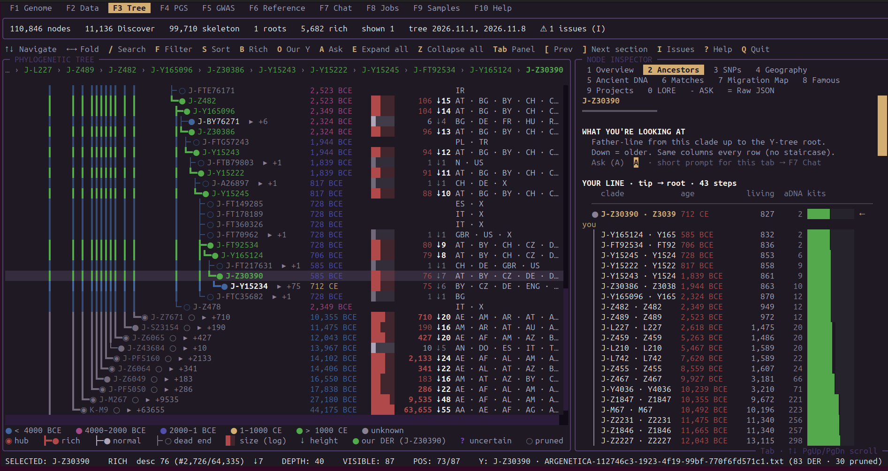
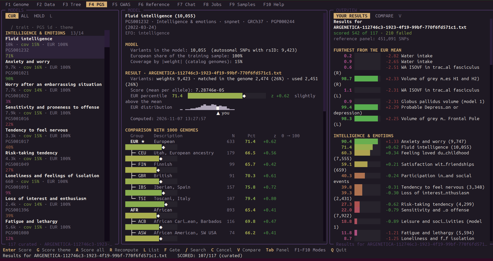
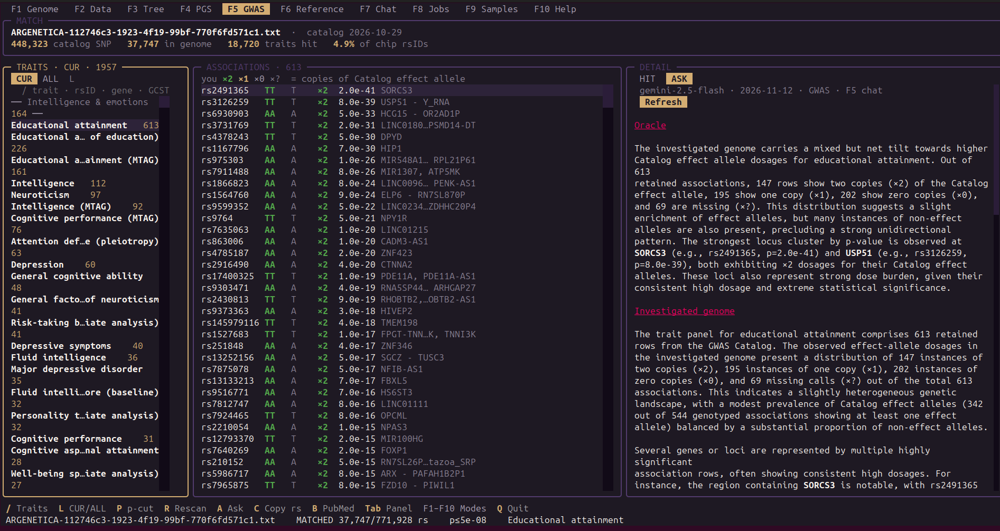
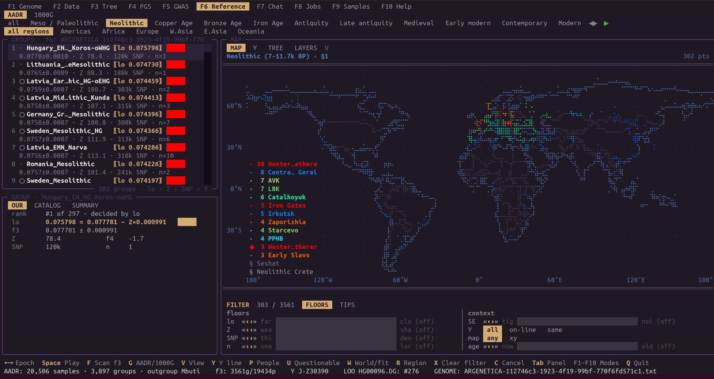
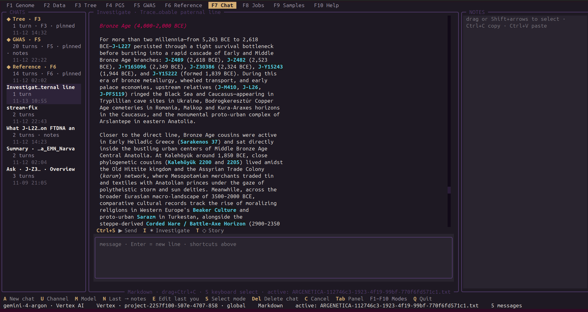

# Make DNA Great Again

Local terminal UI (Textual) for **one person’s** genotype file — not a web report
factory. You keep the data, you choose what to run, screens stay inspectable.

*(Formerly ydna-explorer. CLI stays `ydna`; alias `mdga`.)*

Intended reader: you already know haplogroups and PCA-ish ancestry talk, you are
tired of black-box consumer sites, but you are not living in R/`admixture` yet.
Same guide lives inside the app as **F10 Help** (flow & UX; light on internals).

Modes: **F1 Genome → F2 Data → F3 Tree → F4 PGS → F5 GWAS → F6 Reference → F7 Chat → F8 Jobs → F9 Samples → F10 Help**.

## Tour

A quick look at the TUI.

### F3 · Y Tree

Our paternal branch on the haplotree — ages, geography, Ancestors tab.
Tip **J-Z30390**, path tip→root, Discover-rich nodes.



<table>
<tr>
<td width="50%" valign="top">

### F4 · PGS

Trait scores vs 1000 Genomes — EUR percentile, z-score, theme bars.



</td>
<td width="50%" valign="top">

### F5 · GWAS

Catalog hits on your chip; Ask brief beside the association table.



</td>
</tr>
<tr>
<td width="50%" valign="top">

### F6 · Reference

AADR f₃ by epoch — ranked groups and a world map of sites.



</td>
<td width="50%" valign="top">

### F7 · Chat / Agent

Investigate → Oracle → Story (epochs, cultures). Shortcuts under the thread.



</td>
</tr>
</table>

## Requirements

- Python **3.10+**
- Linux / macOS terminal (Windows untested)
- Optional external data (paths in **F2**):
  - FTDNA Y-DNA Haplotree JSON — **F3** + Y linking
  - FTDNA Discover haplogroup JSON folder — rich **F3** cards
  - AADR panel — **F6**
  - 1000 Genomes PLINK2 set — **F4** / some **F6** layers
  - PGS catalog built in **F2** (or pointed at with **P**) — **F4**
  - GWAS Catalog dump from **F2** — **F5**
  - Gemini API key — **F7**

Formats in **F1**: 23andMe, AncestryDNA, MyHeritage, FTDNA, Argenética; **VCF**
(incl. `.vcf.bz2` / `.vcf.gz`); **FTDNA Big Y** CSV (`Type`/`Position`/`SNPName`/
`Genotype`) and Big Y VCF zip. Archives: `.zip` / `.gz` / `.bz2`. BAM is not
supported. Missing Y SNP names / Known-SNP positions are filled from the FTDNA
haplotree (and TheYtree hg19 when the file is GRCh37).

## Install

### Ubuntu / Debian (binary)

Download the `.deb` or `.tar.gz` from
[GitHub Releases](https://github.com/zogxray/make-dna-great-again/releases)
(or the **Release Linux** Actions artifacts).

```bash
# .deb (amd64)
sudo apt install ./make-dna-great-again_*_amd64.deb
ydna   # also: mdga
```

```bash
# tarball — no root needed
tar xf make-dna-great-again-*-linux-amd64.tar.gz
./ydna/ydna
```

Rebuild locally (needs Python 3.10+ and `dpkg-deb` for `.deb`):

```bash
source ../venv/bin/activate   # or any venv
./packaging/build_linux.sh
```

CI: workflow **Release Linux (Ubuntu/Debian)** — run manually or push a `v*` tag.

### From source

```bash
python3 -m venv .venv
source .venv/bin/activate          # Windows: .venv\Scripts\activate
python -m pip install -U pip
python -m pip install -e .
```

Dependencies from `pyproject.toml`: `textual`, `numpy`, `google-genai`, `duckdb`, `pyarrow`.

Shared DNA venv: activate it and `pip install -e .` from `make-dna-great-again/`.

## Run

```bash
ydna
# or
mdga
# or
python -m ydna
# or
python ydna_tui.py
```

Headless CLI (JSON on stdout, no Textual):

```bash
ydna cli status
ydna cli genome summary [--genome FILE]
ydna cli genome rs rs123 rs456 […]
ydna cli gwas match [--genome FILE] [--gwas-dir DIR] [--p-max 5e-8]
ydna cli gwas search "vitamin D" [--limit 40]
ydna cli gwas trait "Vitamin D levels" [--limit 80]
ydna cli pgs search "vitamin" [--limit 40]
ydna cli profile micronutrients [--age N] [--lab vitamin_d=28]
python -m ydna.cli --help
```

Agent loop (preferred): `status` → `gwas search` / `pgs search` → `gwas trait`
→ `genome rs` → ask the user for labs/context → search again.
`profile micronutrients` is an optional curated shortcut, not the only path.
Responses include `next_queries` / `open_questions` / `need_from_user` hints.

Dual-tier Investigate (Flash plans **tools** → local gather → Argon Oracle →
human **Story** Markdown). Story media uses Discover / Commons **image files**;
F7 renders terminal half-block previews (`pillow`). Tools cover GWAS/PGS **and**
Y path / LORE / AADR epochs / cached 1000G·AADR f3 — any similar question, not a
fixed template:

```bash
ydna cli investigate "…"                         # Oracle + Story (needs Gemini)
ydna cli investigate "…" --no-story              # stop after Oracle
ydna cli investigate "…" --lang Russian          # Story language hint
ydna cli investigate "…" --facts-only            # heuristic tools + gather
ydna cli story [--lang Russian]                  # Story from newest Oracle chat
ydna cli y path | y lore [CLADE] | y milestones
ydna cli aadr hits [--epoch bronze]
ydna cli kg affinity
```

In the TUI **F7 Chat**: shortcut row under the thread — **Ctrl+S** Send ·
**I** Investigate · **T** Story (`GEMINI_FAST_MODEL` + `GEMINI_REASONING_MODEL`;
does not change **M**).

Envelope: `{"ok":true,"data":…}` or `{"ok":false,"error":{"code","message"}}`.
Exit: 0 ok · 2 usage · 3 lock busy · 4 missing data · 1 other.

### MCP (Cursor / other hosts)

Same ops over stdio MCP (`status`, `genome_summary`, `genome_rs`, `gwas_match`,
`gwas_search`, `gwas_trait`, `pgs_search`, `profile_micronutrients`):

```bash
pip install -e ".[mcp]"
python -m ydna.mcp          # or: ydna-mcp
```

Cursor example: copy `packaging/mcp.json.example` into your MCP config; set
`cwd` to this repo and `command` to your venv’s `python`. Close the TUI first
(shared app lock).

Separate desktop window (terminal emulator — not a browser):

```bash
ydna --window
```

```bash
ydna --genome ~/Downloads/genome.txt
ydna --input /path/to/discover/haplogroups --genome ~/kit.txt
```

- `--window` — open in a new terminal window, then return
- `--genome FILE` — preload into **F1** (repeatable)
- `--input DIR` — Discover folder (else path from **F2**)
- `MDGA_TERMINAL=kitty` (etc.) — force which emulator `--window` uses

Quit with **Q** (confirm → shutdown progress in the UI, then exit). App state lives in
`~/.config/make-dna-great-again/ydna.duckdb`
(legacy `~/.config/ydna-explorer` is renamed on first launch).

**One window only.** A second start prints `already running` with a PID — close
that window or `kill <pid>`. You do not need to touch database files.

## Suggested path (first hour)

1. **F1 Genome** — open RAW/TXT/VCF/Big Y.
2. **F2 Data** — at least FTDNA Haplotree; Discover if you want rich Y cards; AADR for F6.
3. **F3 Tree** — walk the tree with **your** branch (**O** = Our Y).
4. **F4 PGS** — after **F2 → PGS models → D** (or **P** to a catalog folder).
5. **F5 GWAS** — after **F2 → GWAS Catalog → D** (or **P**): chip × associations.
6. **F6 Reference** — f3 / ancients (or 1000G) against AADR.
7. **F7 Chat** — Gemini (key in F2).
8. **F8 Jobs** — watch long downloads / Discover / PGS / GWAS / Gemini.
9. **F9 Samples** — Open Humans public kits (filter / get missing / DuckDB).
10. **F10 Help** — this guide inside the TUI.

You can skip screens. Nothing forces a “full report”.

## F1 · Genome

Pick the active genotype and see what is in the file.

- **O** / Ins add files; Enter makes one active.
- Chromosomes + summary: builds, call rates, named Y markers when linked.
- First open may take a few seconds (local store + Y link). Later opens reuse it.
- **VCF**: `GT` → letter alleles; empty `ID` becomes `chrom:pos`, then Y names from
  the haplotree when possible.
- **Big Y CSV**: Known SNP (name → position via haplotree) + Novel Variant (by
  Position). Build defaults to GRCh38.

F1 is the “who am I looking at?” switch — F3/F5/F6 follow the active file.

## F2 · Data

Point the app at reference datasets; download or verify in the background.

**Minimum for a useful Y session:** Haplotree JSON; Discover folder strongly recommended.  
**Minimum for F6:** AADR (`.geno` / `.ind` / `.anno`).

| Source | How it gets on disk |
|--------|---------------------|
| FTDNA Discover | **P** to a folder (optional seed from `ftdna_downloader.py`). Missing nodes: staged fetch **1–5** / **D** below, or **D** / Shift+D in F3. |
| FTDNA Haplotree | **D** in F2, or **P** to an existing JSON. |
| AADR / 1000 Genomes | **D** or **P**. Large downloads. |
| Seshat · Polaris | **D** — polity / religion codes (~3 MB Excel, CC BY-NC). |
| Open Humans | **F9** (or F2 **B**) is the catalog; **D on a row** downloads that genome (any compat) → DuckDB (+ READY → genome). **V**: API new + missing under filter. |
| GWAS Catalog | **D** in F2 — latest FTP snapshot (associations, studies, EFO). Or **P** to a folder. Used by **F5**. |
| PGS models | **D** in F2 (needs F1 genome for coverage), or **P** to an existing catalog folder. |
| Gemini | F2 **P**: AI Studio key, Vertex Cloud project, ADC JSON path. F7 **U** channel; **M** model. F7 / F6 SUMMARY / F5 ASK. |

**Discover fetch stages** (on the Discover source; already-downloaded JSON skipped):

1. **Our** path (tip→root) · **2** Children below Our · **3** This genome ·
4. All F1 genomes · **5** / **A** whole tree (confirm twice).

Direct JSON first; HaplogroupSearch only if the resource 403/404. Progress in **F8**.

URLs and readiness checks are in the F2 detail panel.

## F3 · Tree

Browse the FTDNA Y tree with **your** path marked.

On enter: load tree (cached after first build), then **Our Y** (saved per genome;
recalculated when inputs change). The loader waits for both so the tree does not
flash without you. Our Y tip is scored on the **haplotree** (named SNPs + hg38
position); Discover cards are content, not the tip picker.

- **O** — Our Y tip (cycles tied / near-tie forks; `?` uncertain, `○` pruned) · `/` search · **F** filter · **S** sort · **B** rich branches  
- Card tabs: overview … LORE · **ASK** · raw JSON. Discover pages load on demand  
- **A** — Ask → **ASK** tab + pinned F7 chat **Tree · F3** (read-only there)  
- **D** / Shift+D — fetch missing Discover JSON (needs F2 path)  

YFull / TheYtree overlays (if set in F2) are read-only extras; they do not rewrite FTDNA topology.

## F4 · PGS

Score curated polygenic models on the active genome; optionally compare to another
file or 1000 Genomes-style refs from the catalog.

Build the catalog once in **F2 → PGS models → D** (needs F1 for SNP coverage), or
**P** to an existing work folder with `catalog/catalog.tsv`.

- **L** — CUR (shortlist) / ALL (catalog) / HOLD (triage); on ALL: **F** gate filter  
- **G** / **A** — score theme or all · results stick for that genome  

Effect sizes on *your* SNPs — not medical advice.

## F5 · GWAS

Match the active F1 genome against the local GWAS Catalog associations table
(from **F2 → GWAS Catalog → D** / **P**).

First match builds a local DuckDB index under `~/.cache/make-dna-great-again/gwas_index/`
(one-time per catalog file); later matches join in ~1–3s. Fallback:
`MDGA_GWAS_MATCH=python`.

- Traits: **L** — **CUR** (themed shortlist) / **ALL** (every matched trait)  
- Associations for the selected trait · detail **HIT** / **ASK**  
- **A** / ASK — scientific note in-tab via shared chat **GWAS · F5** (Gemini key in F2)  
- **P** cycles p-value cut · **/** search traits · **R** rescan · **C** copy rsID · **B** PubMed  
- First scan can take a minute; results cache by genome + catalog mtime + cut  

Not a polygenic score — that is **F4**.

## F6 · Reference

Your genome next to published panels — mainly **AADR** (and optionally 1000G),
with f3-style results you computed offline.

Opening F6 loads: AADR **catalog** (who the groups are + Y labels), **your result
bundles**, and **Y relation tags** (same / ancestor / downstream / other), same
Our Y idea as F3. “Loading AADR…” means that whole package.

- **F** — scoring jobs · **G** — AADR ↔ 1000G · map / tree / layers lenses  

Left column: **GROUPS** (list) above **GROUP** (card).  

**LAYERS** (smartpca / qpAdm / imputation / ChromoPainter) need lab binaries on
`PATH` — optional research tools, not the default path.

## F7 · Chat

Threads with Gemini (channel **U** / model **M** in F7; keys in F2).

- Left chats · center transcript · right NOTES (yours)
- Shortcut row under the thread (clickable): **Ctrl+S** ▶ Send · **I** ✶
  Investigate · **T** ◇ Story
- **✶** Investigate = plan → local facts → Oracle → Story Markdown
- Story images: `` → inline half-block preview in the TUI
  (needs `pillow`; real image URLs / Commons thumbs, not HTML search pages)
- Enter = new line in the prompt; replies stream and are stored locally
- **N** last reply → NOTES · **S** select mode for copy
- After ✶, **▶** follow-ups (e.g. translate) see the last model via Studio
  continue or a local prior-text bridge

The model does not auto-read your RAW file — talk from F3–F6 findings or paste.

## F8 · Jobs

Background task monitor (list + detail). Downloads, Discover fetches, PGS, GWAS.
Tasks still **start** from F2/F3/F4/F5/F7; F8 watches them. **P** pause/resume,
**A** pause all, **C** cancel (or drop a queued item), **X** clear finished.
Discover stages 1–5 on F2 enqueue onto the same slot when one is already active.

## F9 · Samples

Open Humans catalog is the mode itself (no landing / B). **D** on a row downloads
that genome; ● READY / ○ NEED are labels — NEED is not blocked. **V** = API new + missing.

## F10 · Help

In-app copy of this flow guide. Scroll with ↑↓ / PgUp/Dn.

## Mental model

| Mode | Question it answers |
|------|---------------------|
| F1 | Which file is active? What SNPs / Y names does it carry? |
| F2 | Where is the reference data? Is it complete? |
| F3 | Where am I on the Y tree? What do Discover cards say? |
| F4 | How do PGS models land on *my* genotypes? |
| F5 | Which curated GWAS hits land on *my* chip SNPs? |
| F6 | How do I sit among ancients / reference pops (f3 + Y tags)? |
| F7 | Can I think out loud with a model, with notes beside? |
| F8 | What is running in the background right now? |
| F9 | Which public samples do I have / still need? |
| F10 | What is the intended path through the app? |

Everything important stays on your machine. Slow first opens are usually “build
or unpack a cache once”; warm revisits should feel light.

## Keys (common)

- **F1–F10** — switch mode  
- **Tab** — next panel  
- **Q** — quit  
- Mode-specific hints sit on the bottom key bar of each screen  

## Development

```bash
source .venv/bin/activate
pip install -e .
python -m ydna --genome /path/to/kit.txt
```

**Local mode-load profile** (uses your private `data/`; **close the TUI first**):

```bash
pip install -e '.[dev]'
python -m ydna.bench.mode_load              # F1→F10 wall times + UI-thread cProfile
python -m ydna.bench.mode_load --deep-only  # profile catalog/tree/AADR/PGS loaders only
MDGA_LOCAL_BENCH=1 pytest tests/test_mode_load_profile.py -s
```

Reports → `~/.cache/make-dna-great-again/bench/` (not `data/`). Summaries avoid kit paths.

Package layout: `ydna/` (app + workspaces + core). Entry: `ydna` → `ydna.__main__:main`.
